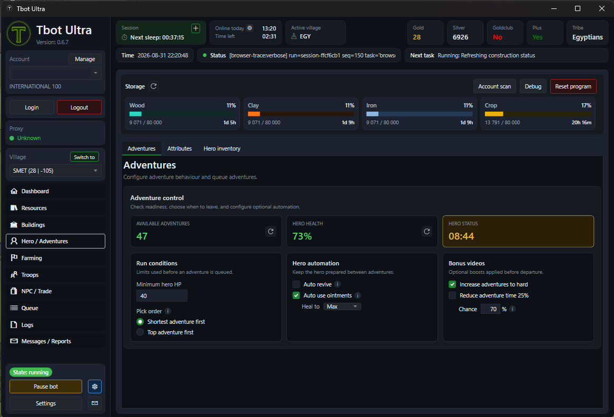

# TravianBot Ultra

  

TravianBot Ultra is a configurable Windows automation tool for official Travian Legends servers. It handles repetitive village, resource, farming, troop, construction and hero tasks.

> Travian must use English in the in-game browser settings.

## Download and start

Download the latest `tbot-ultra-win-x64-...-portable.zip` from [Releases](../../releases/latest).

1. Extract the complete zip to a writable folder, such as your Desktop.
2. Run `Tbot Ultra.exe` inside the extracted folder.
3. Create or sign in to your Tbot account.
4. Add your Travian account under **Account → Manage**.
5. Click **Login**, configure the features you want and click **Start bot**.

Windows may show a SmartScreen warning because the application is not digitally signed. Choose **More info → Run anyway** if prompted.

Do not move `Tbot Ultra.exe` out of its extracted folder. The other files in that folder are required. The `.sha256` release asset is only for verifying the downloaded zip.

## Program copies

One Tbot account may register up to two separate program folders. Both may run on the same computer. Extract a separate portable folder for each copy; do not run two instances from the same folder.

## Features

- Automatic buildings and resource fields
- Multi-village configuration
- Hero adventures, revival, attributes and inventory resources
- Daily quests and task rewards
- NPC trading and resource transfers
- Smithy upgrades and troop training
- Reinforcements between your villages
- Farming and configurable farm lists
- Oasis scanning and inactive-player search
- Catapult waves
- Town hall and brewery celebrations
- Reports and messages
- Incoming-attack handling
- Proxy support per account
- Reusable building templates
- Configurable pacing, idle browsing and sleep periods
- In-app update notifications
- Sanitized diagnostic packages for support

Most features can be configured separately for each village.

## Updates

The application checks this repository for new releases and displays an update notification when a newer version is available.

## Support and community

- [Tbot Ultra website](https://tbot-ultra.pages.dev)
- [Discord community](https://discord.gg/7bgzKy9sHK)
- [Report a problem or request a feature](../../issues)

## Disclaimer

Using bots or automation software violates Travian's rules and may result in account suspension or a permanent ban. Use this software at your own risk. No usage pattern is guaranteed to be safe or undetectable.

Travian account credentials and per-account game data are stored locally in the extracted program folder.

---

This public repository contains downloads and user support information. Development is maintained privately.
